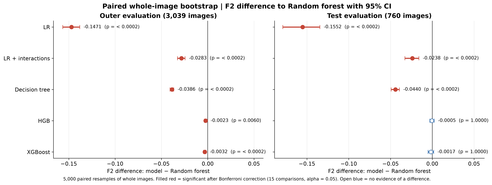
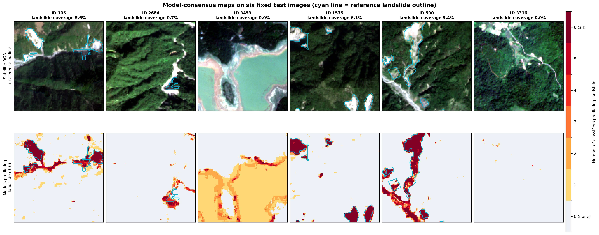
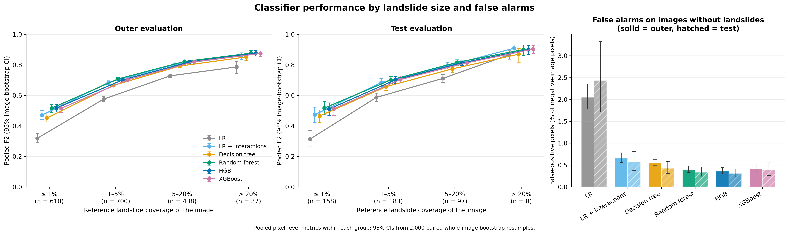
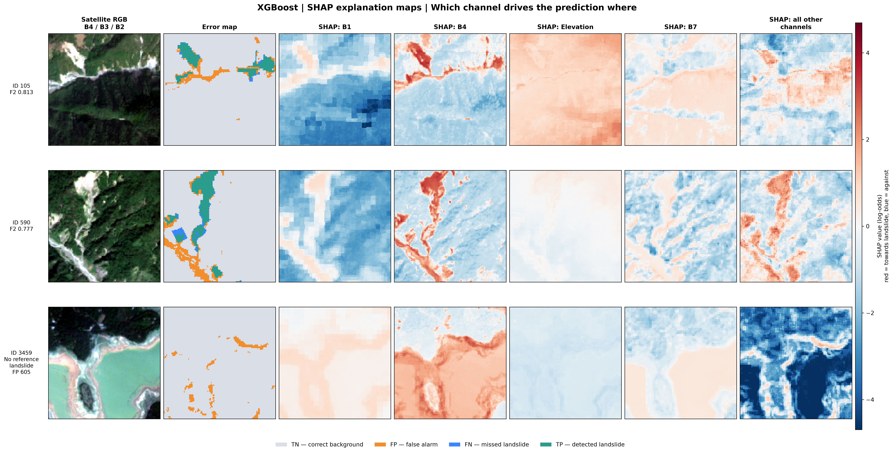

# Pixel-Based Landslide Detection from Sentinel-2 and Terrain Data

**A statistical comparison of six supervised classifiers on the Landslide4Sense benchmark**


Author: **Nooshin Hadidian Moghaddam**

> This file describes the landslide-detection project. The original `README.md` in this folder belongs to the course template and is kept unchanged.

---

## Overview

Rapid, reliable landslide maps are needed after earthquakes and extreme rainfall. This project tests how well classical supervised classifiers can detect landslides **pixel by pixel** from Sentinel-2 multispectral images and terrain data, and whether the differences between classifiers are statistically and practically meaningful.

Six classifiers were compared under one identical evaluation protocol:

| Family | Classifier |
|---|---|
| Linear models | Logistic regression (LR), LR with 91 pairwise interaction terms |
| Single tree | Decision tree |
| Tree ensembles | Random forest, histogram gradient boosting (HGB), XGBoost |

### Key findings

- **Tree ensembles detect landslides best and are practically equivalent:** test F2 0.765–0.767; a Bayesian analysis gives P(|ΔF2| < 0.01) = 1.00 for every ensemble pair.
- **High recall, moderate precision:** the ensembles find about 86 % of landslide pixels, but about one in two flagged pixels is a false alarm.
- **Landslide size matters more than the classifier:** F2 of the best model rises from about 0.52 (≤ 1 % landslide coverage) to about 0.88 (> 20 %).
- **All models share the same key errors:** bright riverbeds are flagged by every classifier, and 8 % of landslide pixels are missed by all six. SHAP explanations trace this to the red band B4.
- **Secondary differences decide the choice:** random forest gives the best-calibrated probabilities; XGBoost predicts 2.5× faster and is far cheaper to train.



---

## Results

| Classifier | Outer CV F2 [95 % CI] (3,039 images) | Test F2 [95 % CI] (760 images) | Precision | Recall | IoU | Avg. precision |
|---|---|---|---|---|---|---|
| **Random forest** | **0.776** [0.768, 0.784] | **0.767** [0.747, 0.786] | 0.535 | 0.860 | 0.492 | 0.780 |
| HGB | 0.774 [0.765, 0.782] | 0.766 [0.747, 0.785] | 0.527 | 0.864 | 0.487 | 0.774 |
| XGBoost | 0.773 [0.764, 0.781] | 0.765 [0.745, 0.784] | 0.530 | 0.860 | 0.488 | 0.773 |
| LR + interactions | 0.748 [0.738, 0.757] | 0.743 [0.720, 0.765] | 0.511 | 0.838 | 0.465 | 0.738 |
| Decision tree | 0.738 [0.728, 0.747] | 0.723 [0.700, 0.744] | 0.529 | 0.796 | 0.466 | 0.697 |
| Logistic regression | 0.629 [0.614, 0.643] | 0.612 [0.577, 0.643] | 0.360 | 0.741 | 0.320 | 0.504 |

Precision, recall, IoU and average precision refer to the secondary test set. Confidence intervals come from a paired whole-image bootstrap.

| Model consensus on six test images | Performance by landslide size |
|---|---|
|  |  |



---

## Data

[Landslide4Sense](https://www.kaggle.com/datasets/tekbahadurkshetri/landslide4sense) benchmark (Ghorbanzadeh et al., 2022):

- 128 × 128-pixel patches at about 10 m resolution with **14 layers**: Sentinel-2 bands B1–B12, plus slope and elevation (DEM) from ALOS PALSAR.
- Four study areas: Iburi (Japan), Kodagu (India), Rasuwa/Gorkha (Nepal) and western Taitung (Taiwan).
- Only the 3,799 training patches have masks. They were split by image into **3,039 development** and **760 secondary-test** patches, stratified by landslide presence.
- Strong class imbalance: only **2.32 %** of pixels are landslide (about 1 : 42).

The data are **not included** in this repository (about 6.7 GB). To reproduce the analysis, download `archive.zip` from Kaggle and extract it to:

```
data/archive/
├── TrainData/img/   TrainData/mask/
├── ValidData/img/
└── TestData/img/
```

---

## Method

All classifiers followed the same protocol:

1. **Image-level split:** all pixels of an image stay together (no leakage between neighbouring pixels).
2. **Nested cross-validation:** 5 outer × 3 inner folds, identical for every classifier.
3. **Pixel sampling for training, full images for evaluation:** 512 or 1,024 sampled pixels per image for training; every evaluation image is scored on all 16,384 pixels.
4. **Selection on inner folds only:** hyperparameters, optional calibration and the decision threshold (101 values) chosen by maximum F2.
5. **Final model:** the same search on three development folds, one fit on all 3,039 images, then locked.
6. **Secondary test:** the locked model predicts the 760 test images once.

**Primary metric:** F2 = 5·TP / (5·TP + 4·FN + FP). Recall is weighted four times as heavily as precision, because a missed landslide costs more than a false alarm.

**Statistics:** paired whole-image bootstrap, Wilcoxon signed-rank tests with Bonferroni correction, a Bayesian bootstrap with a region of practical equivalence (±0.01 F2), Cochran's Q and McNemar tests, and difference-in-differences tests by landslide size.

**Explainability:** permutation importance for all tree models and exact SHAP values for XGBoost.

---

## Repository structure

| File / folder | Content |
|---|---|
| [`satellite_damage_analysis.ipynb`](satellite_damage_analysis.ipynb) | Data loading, exploratory analysis, split, **logistic regression** and **LR with interactions** |
| [`ML_tree models.ipynb`](ML_tree%20models.ipynb) | **Decision tree**: search, calibration, nested CV, test, importance |
| [`ML_random forest.ipynb`](ML_random%20forest.ipynb) | **Random forest**: search, tree-count and sample-size checks, nested CV, test, importance |
| [`HGB_ML.ipynb`](HGB_ML.ipynb) | **Histogram gradient boosting**: candidate search, nested CV, test, importance |
| [`XGB_ML.ipynb`](XGB_ML.ipynb) | **XGBoost**: candidate search, nested CV, test, permutation importance, SHAP |
| [`Comparison_ML.ipynb`](Comparison_ML.ipynb) | **Statistical comparison** of all six classifiers (bootstrap, Wilcoxon, Bayesian ROPE, McNemar, size analysis, consensus maps, calibration and cost) |
| [`Landslide_Detection_Report_NHM.pdf`](Landslide_Detection_Report_NHM.pdf) | Full scientific report |
| [`Presentation_landslide_detection_project_NHM.pdf`](Presentation_landslide_detection_project_NHM.pdf) | Slides of the 10-minute presentation |
| [`artifacts/classifier_comparison/`](artifacts/classifier_comparison/) | Comparison tables (CSV) and figures (PNG/PDF) |
| `artifacts/<model>/…` | Per-model figures; large checkpoints are excluded (see below) |
| [`data/artifacts/lr_fixed_spatial_results/`](data/artifacts/lr_fixed_spatial_results/) | Spatial results of the two logistic regression models |
| `pyproject.toml`, `uv.lock` | Python environment |

**Not included in the repository** (see `.gitignore`): the raw data and the model checkpoints (`*.joblib`, `*.npy`, `*.npz`, about 18 GB). They are recreated when the notebooks are run.

---

## How to reproduce

```bash
# 1. Install the environment (Python 3.13, uv)
uv sync
uv add xgboost          # if not yet listed in pyproject.toml

# 2. Download Landslide4Sense and extract it to data/archive/

# 3. Run the notebooks in this order
satellite_damage_analysis.ipynb   # creates the split and the shared hand-off files
ML_tree models.ipynb
ML_random forest.ipynb
HGB_ML.ipynb
XGB_ML.ipynb
Comparison_ML.ipynb               # needs the exported results of all models
```

Run times on a laptop: the XGBoost nested search took about 73 minutes and the random forest nested search about 40 hours; the other models are considerably faster than the random forest. The notebooks save checkpoints, so interrupted runs can be resumed.

Software: Python 3.13, scikit-learn 1.9.0, XGBoost 3.4.1, NumPy 2.4.6, pandas 3.0.3.

---

## Limitations and next steps

| Limitation | Next step |
|---|---|
| Single pixels only: riverbeds look like landslides | Spatial context: U-Net / transformer segmentation or texture features |
| Small landslides are often missed | Pre-/post-event change detection, multi-scale inputs |
| Optical data only: clouds can hide an event | Add Sentinel-1 radar |
| Same four regions in development and test | Region-wise cross-validation on unseen regions |
| Test images were already inspected during the LR analysis | Evaluate once on a completely untouched region |

---

## References

- Ghorbanzadeh, O., Xu, Y., Ghamisi, P., Kopp, M., & Kreil, D. (2022). Landslide4Sense: Reference benchmark data and deep learning models for landslide detection. *IEEE Transactions on Geoscience and Remote Sensing*, 60. https://doi.org/10.1109/TGRS.2022.3215209
- Breiman, L. (2001). Random forests. *Machine Learning*, 45(1), 5–32.
- Chen, T., & Guestrin, C. (2016). XGBoost: A scalable tree boosting system. *Proceedings of KDD 2016*, 785–794.
- Lundberg, S. M., & Lee, S.-I. (2017). A unified approach to interpreting model predictions. *Advances in Neural Information Processing Systems*, 30.

## Acknowledgements

Project carried out within the neuefische Data Science course; the repository is based on the course's ML project template (MIT License, see [`LICENSE`](LICENSE)). Data: Landslide4Sense competition (IARAI / Ghorbanzadeh et al.).
